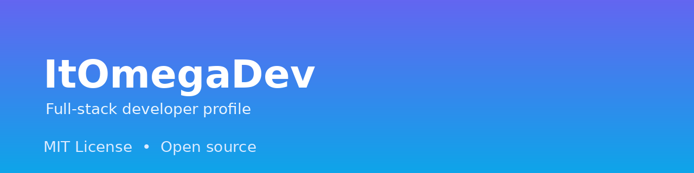

# ItOmegaDev

I'm **Mikhail (Omega)** — Software Engineer focused on **Full-Stack & Infrastructure**.

I build web applications, backend services, automation tools and game-server infrastructure. My work combines product development with Linux, Docker, networking and security-minded operations.

## Focus areas

- **Full-Stack Web Development** — Next.js, React, TypeScript, Node.js, Express, MongoDB, PostgreSQL
- **Backend & APIs** — REST APIs, authentication, databases, server-side logic
- **DevOps & Infrastructure** — Linux, Docker, Nginx, SSH, CI/CD, self-hosting
- **Game Server Engineering** — Minecraft Velocity/Purpur, plugins, configuration, performance
- **Automation & AI Integration** — scripts, bots, API integrations, local AI workflows

## Featured projects

| Project | Stack | Description |
|---|---|---|
| [discord-auth](https://github.com/ItOmegaDev/discord-auth) | Java, Velocity | Discord verification and password gate for Minecraft proxy players |
| [EdgeProxy](https://github.com/ItOmegaDev/EdgeProxy) | Go, Node.js, React | Edge reverse proxy, tunneling agent, dashboard and DDoS shield |
| [ControlPanel](https://github.com/ItOmegaDev/ControlPanel) | React, TypeScript, Vite | Game-server management dashboard concept |
| [Pedagogical-hub](https://github.com/ItOmegaDev/Pedagogical-hub) | React, Firebase | Platform for sharing educational materials |
| [Yulia](https://github.com/ItOmegaDev/Yulia) | React, Node.js, Firebase | Bespoke tailoring storefront and admin panel |
| OmegaOS | HTML, CSS, JavaScript | Browser-based desktop-style OS demo |
| [OmegaSMP](https://omegasmp.pp.ua) | Velocity, Purpur | Semi-anarchy Minecraft network with cross-play and custom plugins |

## Services

**Omega.jar — web development under key**

- Landing pages: from $60
- Portfolio / business card sites: from $50
- Simple pages: from $30
- Mobile adaptation: included
- Fixes and small improvements: from $5

Terms: 50% prepayment, full source code included, 3 days of free revisions.

## Minecraft network

- Public address: `omegasmp.pp.ua`
- Java + Bedrock cross-play
- Discord verification and password-based access
- Custom Velocity/Purpur plugins and security-focused setup

## Contact

- GitHub: https://github.com/ItOmegaDev
- Fiverr: https://www.fiverr.com/s/d0pRVwa
- Telegram: https://t.me/ItOmega
- Channel: https://t.me/DevOmegaTgk
- Community chat: Omega Chat

## Security

Security-first workflow: no secrets in repositories, environment-based configuration, and minimal public exposure of internal services.

## License

Profile content and original code in this repository are released under the [MIT License](LICENSE).

## Українською (коротко)

Я — Михайло (Omega), Software Engineer з фокусом на Full-Stack & Infrastructure. Роблю вебзастосунки, backend/API, автоматизацію, Linux/Docker-інфраструктуру та ігрові сервери. Тут зібрані мої публічні проєкти, контакти та коротка інформація про послуги.